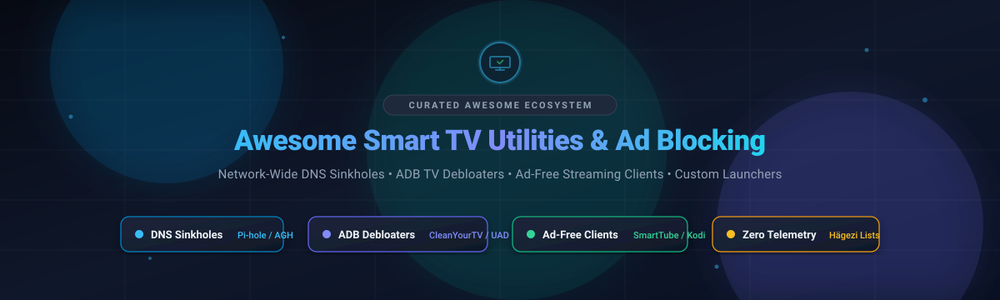

# 📺 Awesome Smart TV Utilities & Ad Blocking Optimization 🛡️

> 🚀 A curated list of production-grade SaaS cloud DNS platforms, network-wide DNS sinkholes, Android TV &amp; Fire TV ADB debloaters, open-source custom launchers, and telemetry-blocking utilities for Smart TVs.

**📅 Last updated: November 2026**

---

## 📖 Overview

Modern Smart TVs (Android TV, Google TV, Amazon Fire TV, Samsung Tizen, LG webOS, and Roku) increasingly ship with aggressive telemetry trackers, sponsored home screen carousels, unskippable video ads, and unremovable OEM bloatware. 

This repository catalogs top **SaaS cloud DNS filtering platforms** and **open-source utilities** designed to:
- 🚫 **Block living-room ads &amp; tracking**: Strip DNS telemetry, ACR (Automatic Content Recognition) tracking, and video ads at the network or application level.
- 🧹 **Debloat Smart TV hardware**: Safely disable manufacturer bloatware, telemetry packages, and stock home launchers via ADB without rooting.
- ⚡ **Speed up media performance**: Replace resource-heavy stock launchers with fast, clean, ad-free alternatives (such as FLauncher, Kodi, and Jellyfin) and ad-free media players (such as SmartTube and NewPipe).

---

## 📑 Table of Contents

- [📊 Sector Overview &amp; Market Dynamics](#-sector-overview--market-dynamics)
- [☁️ SaaS &amp; Hosted DNS Filtering Platforms](#️-saas--hosted-dns-filtering-platforms)
- [💻 Open-Source GitHub Projects](#-open-source-github-projects)
  - [🛡️ DNS Sinkholes &amp; Encrypted Resolvers](#️-dns-sinkholes--encrypted-resolvers)
  - [🧹 Smart TV Debloaters &amp; System Optimization](#-smart-tv-debloaters--system-optimization)
  - [🎬 Ad-Free Media Clients &amp; Players](#-ad-free-media-clients--players)
  - [🚀 Custom Launchers &amp; TV Utilities](#-custom-launchers--tv-utilities)
  - [📋 Curated Smart TV Blocklists](#-curated-smart-tv-blocklists)
- [🏗️ Recommended Stack Architecture](#️-recommended-stack-architecture)
- [🌟 Star History](#-star-history)
- [🤝 Support](#-support)
- [✍️ How to Contribute](#️-how-to-contribute)
- [⚠️ Disclaimer](#️-disclaimer)

---

## 📊 Sector Overview &amp; Market Dynamics

The global DNS security software and filtering market is valued at approximately **$1.57 billion to $2.1 billion in 2026** (expanding at an 8.4%–11.5% CAGR), while the broader consumer privacy and ad-blocking software industry represents a **$4.2 billion to $4.6 billion** ecosystem driven by over 1.1 billion worldwide users seeking relief from intrusive digital ads and tracking.

From a structural perspective, the market displays **bifurcated moderate fragmentation**:
- 🏢 **Enterprise &amp; Public Infrastructure (Concentrated Core)**: Giant networking and cybersecurity conglomerates such as Cisco Systems (Umbrella) and Cloudflare dominate upstream Anycast recursive routing and enterprise secure web gateways (SWG/SASE).
- 🌐 **Consumer Privacy &amp; Smart TV Filtering (Highly Fragmented Long Tail)**: Driven by zero-logging requirements, cord-cutting, and connected TV (CTV) ad fatigue, a dynamic ecosystem of independent SaaS pioneers (NextDNS, Control D, AdGuard) and community-driven open-source projects (Pi-hole, SmartTube, Hagezi Blocklists) maintain strong user loyalty through open protocols (DoH, DoT, DoQ) and specialized OEM tracker blocking rules.

---

## ☁️ SaaS &amp; Hosted DNS Filtering Platforms

The table below summarizes leading hosted DNS filtering and ad-blocking services, sorted descending by corporate scale (valuation / market capitalization / revenue).

| 🏢 Platform | 💰 Company Scale (Valuation / Revenue) | 🏷️ Starting Pricing (Specific Tier) | 🎁 Free Tier Limits (Perpetual Limits / Free Trial) | 🎯 Key Smart TV Capabilities |
| :--- | :--- | :--- | :--- | :--- |
| **[Cisco Umbrella](https://umbrella.cisco.com)** | **~$360B Market Cap** (Parent: Cisco Systems) | **$2.25 – $3.00/user/mo** (*DNS Security Essentials*, ~$30–$40/user/yr via partners) | **14-day free trial** with full threat protection; consumer version (*OpenDNS FamilyShield*) offers permanent free unmanaged blocking (`208.67.222.123`) | Enterprise-grade recursive threat filtering; blocks malicious C2 callbacks and phishing across LAN and IoT TV devices. |
| **[Cloudflare 1.1.1.1 for Families](https://one.one)** | **~$98B Market Cap** (Cloudflare, Inc. [NYSE: NET]) | **$0.00** (Free public service; Zero Trust tier starts at **$7.00/user/mo**) | **100% Free Forever** (Unlimited queries, zero rate caps on public resolvers `1.1.1.2` and `1.1.1.3`) | Global Anycast network; blocks malware and adult content on Smart TVs at zero latency with no software installation required. |
| **[AdGuard DNS](https://adguard-dns.io)** | **~$5M – $10M Annual Revenue** (Bootstrapped profitable entity) | **$2.49/mo** (Billed annually at $29.88/yr for *Personal* plan; $2.99 billed monthly) | **300,000 queries/month free forever**; unmanaged public DNS (`94.140.14.14`) is free forever with unlimited queries | Dedicated Smart TV blocking lists, DoH/DoT/DoQ configuration, custom block rules, and parental control toggles per TV profile. |
| **[NextDNS](https://nextdns.io)** | **Bootstrapped / Profitable** (Est. Multi-Million ARR, 100K+ paying users) | **$1.99/mo** (Billed annually at $19.90/yr for *Pro* plan; unlimited queries) | **300,000 queries/month free forever** (filtering reverts to standard DNS resolution once monthly limit is exceeded; no account cutoff) | Dedicated native tracker blocklists for Samsung, LG, Sony, Roku, Hisense, and Xiaomi TVs; detailed real-time query logs. |
| **[Control D](https://controld.com)** | **Privately Held / Windscribe Subsidiary** (Est. Multi-Million ARR) | **$3.00/mo** (Or $30/yr for *Some Control*; $6.00/mo or $60/yr for *Full Control* with proxy redirect) | **14-day free trial** with full dashboard access (no credit card required); unmanaged public DNS resolvers free forever with unlimited queries | Deep Smart TV telemetry filtering, granular single-click service blocking, and Geo-DNS traffic redirection without running VPN apps on TV. |
| **[AdLock](https://adlock.com)** | **Privately Held Commercial Business** (Est. Multi-Million ARR) | **$3.29/mo** (Billed annually at $39.50/yr; or $9.95 billed monthly; 5-device plan) | **14-day free trial** for system-wide Android TV apps; free browser extensions for Web browsers | System-wide app traffic filtering, video ad stripping, and encrypted DNS profiles for Android TV and Fire OS. |
| **[Blokada Cloud](https://blokada.org)** | **~$550K – $600K Annual Revenue** (Blocka AB) | **$3.99/mo** (Or ~$39.99/yr for *Blokada Cloud* / *Blokada 6*) | **7-day free trial** for cloud service; open-source Android app (*Blokada 5 Libre*) is 100% free forever for local on-device filtering | Cloud-managed WireGuard and encrypted private DNS profiles that filter Smart TV trackers before reaching the device. |
| **[CleanBrowsing](https://cleanbrowsing.org)** | **~$300K – $500K Annual Revenue** (Bootstrapped niche provider) | **$5.00/mo** (Billed annually at $59.99/yr for *Basic Home* plan covering 25 devices) | **100% Free Forever** on 3 preconfigured Anycast filter profiles (*Security*, *Adult*, *Family Filter*); unlimited queries without an account | Zero-configuration DNS protection for routers and Smart TVs; enforces SafeSearch across YouTube, Google, and Bing. |
| **[Quad9](https://quad9.net)** | **Swiss Non-Profit Foundation** (Funded via institutional grants &amp; donations) | **$0.00** (Non-profit foundation model supported by global sponsors) | **100% Free Forever** (Unlimited queries, zero rate caps, zero PII logging on `9.9.9.9` and DoH/DoT endpoints) | Non-profit threat intelligence aggregator blocking botnets, spyware, phishing, and Smart TV tracking domains globally. |

---

## 💻 Open-Source GitHub Projects

All open-source tools below are actively maintained and sorted in **descending order by GitHub Stars_Count**. Each repository badge links directly to its live stargazers page.

### 🏆 All Open-Source Projects (Ranked by Stars)

| 📦 Project | ⭐ GitHub_Stars | 🏷️ Category | 🎯 Primary Focus |
| :--- | :--- | :--- | :--- |
| **[Pi-hole](https://github.com/pi-hole/pi-hole)** |  | 🛡️ DNS Sinkhole | Network-wide DNS sinkhole running on Linux/Raspberry Pi protecting Smart TVs across your LAN. |
| **[CleanYourTV](https://github.com/Gathin23/CleanYourTV)** |  | 🧹 TV Debloater | Automated ADB optimization toolkit to debloat Android TV &amp; Google TV over Wi-Fi for an Apple TV-style home. |
| **[Jellyfin](https://github.com/jellyfin/jellyfin)** |  | 🎬 Media Server | 100% free software media system server backend with zero ads, tracking, or cloud surveillance. |
| **[NewPipe](https://github.com/TeamNewPipe/NewPipe)** |  | 📺 Media Client | Lightweight Android streaming frontend with native ad-blocking, background playback, and no Google Services. |
| **[AdGuard Home](https://github.com/AdguardTeam/AdGuardHome)** |  | 🛡️ DNS Sinkhole | Golang network-wide ad &amp; tracker blocking DNS server with built-in web management and DoH/DoT/DoQ. |
| **[SmartTube](https://github.com/yuliskov/SmartTube)** |  | 📺 Media Client | Open-source ad-free YouTube player for Android TV &amp; Fire TV with SponsorBlock, 4K HDR, and adjustable playback speeds. |
| **[Hägezi DNS Blocklists](https://github.com/hagezi/dns-blocklists)** |  | 📋 Filter Rules | Curated DNS blocklists with specialized Native Tracker protection for Samsung, LG, Roku, and Amazon TVs. |
| **[FreeTube](https://github.com/FreeTubeApp/FreeTube)** |  | 🎬 Media Player | Desktop &amp; HTPC private YouTube client blocking tracking and video ads without user account requirements. |
| **[Kodi](https://github.com/xbmc/xbmc)** |  | 🍿 Media Center | Extensible open-source home theater software for Android TV with zero ads and extensive plugin ecosystems. |
| **[Universal Android Debloater](https://github.com/0x192/universal-android-debloater)** |  | 🧹 TV Debloater | Cross-platform Rust ADB GUI to safely remove bloatware, tracking, and OEM apps on non-rooted Android TVs. |
| **[SponsorBlock](https://github.com/ajayyy/SponsorBlock)** |  | ⏭️ Extension / API | Crowdsourced database and API engine that skips sponsored segments within videos on Smart TV apps. |
| **[dnscrypt-proxy](https://github.com/DNSCrypt/dnscrypt-proxy)** |  | 🔒 DNS Proxy | Flexible encrypted DNS proxy supporting DNSCrypt, DoH, local blocklists, DNS cloaking, and DNSSEC. |
| **[Pi-hole Docker](https://github.com/pi-hole/docker-pi-hole)** |  | 🐳 Container / DNS | Official Pi-hole containerized deployment image for Docker, Kubernetes, and home-server routers. |
| **[Technitium DNS Server](https://github.com/TechnitiumSoftware/DnsServer)** |  | 🛡️ DNS Server | Cross-platform C# authoritative and recursive DNS server with built-in ad-blocking, DoH/DoT, and web GUI. |
| **[UAD-NG](https://github.com/Universal-Debloater-Alliance/universal-android-debloater-next-generation)** |  | 🧹 TV Debloater | Maintained next-generation fork of Universal Android Debloater with updated package definitions for modern Smart TVs. |
| **[PipePipe](https://github.com/InfinityLoop1308/PipePipe)** |  | 📺 Media Client | Multi-platform open-source streaming client for Android TV with built-in SponsorBlock and zero telemetry. |
| **[Blocky](https://github.com/0xERR0R/blocky)** |  | 🛡️ DNS Proxy | Fast Go-based DNS proxy and ad blocker engineered for home labs, custom device groups, and Prometheus metrics. |
| **[RethinkDNS](https://github.com/celzero/rethink-app)** |  | 🔒 DNS / Firewall | On-device DNS-over-HTTPS/Tor resolver, WireGuard manager, and per-app network firewall for Android TV. |
| **[Unbound](https://github.com/NLnetLabs/unbound)** |  | ⚡ DNS Resolver | High-performance validating, recursive, caching DNS resolver often paired with Pi-hole and AdGuard Home. |
| **[Jellyfin Android TV](https://github.com/jellyfin/jellyfin-androidtv)** |  | 📺 TV Client | Dedicated, native leanback client for Jellyfin on Android TV and Google TV with zero advertisement banners. |
| **[Blokada Libre](https://github.com/blokadaorg/blokada)** |  | 📱 On-Device DNS | On-device local VPN-based DNS sinkhole for Android TV filtering ads without external server routing. |
| **[TizenTube](https://github.com/reisxd/TizenTube)** |  | 📺 Tizen Client | TizenBrew module removing ads and enabling SponsorBlock playback directly on Samsung Tizen Smart TVs. |
| **[Pi-hole FTL](https://github.com/pi-hole/FTL)** |  | ⚙️ Core Engine | High-speed C-based Faster-Than-Light DNS caching and filtering engine powering Pi-hole deployments. |
| **[YouTube AdFree webOS](https://github.com/webosbrew/youtube-webos)** |  | 📺 webOS Client | Ad-free YouTube web app with native SponsorBlock integration specifically tailored for LG webOS TVs. |
| **[Aerial Views](https://github.com/theothernt/AerialViews)** |  | 🖼️ Screensaver | Clean, telemetry-free Apple TV-style 4K HDR video screensaver for Android TV, Google TV, and Fire TV. |
| **[Kodi YouTube Plugin](https://github.com/anxdpanic/plugin.video.youtube)** |  | 🔌 Kodi Plugin | Open-source Kodi addon allowing full YouTube video streaming without commercial ad intermissions. |
| **[IPTV Simple Client](https://github.com/kodi-pvr/pvr.iptvsimple)** |  | 📡 Kodi PVR | Open-source Kodi PVR addon to load custom M3U playlists, XMLTV guides, and clean live streams. |
| **[FLauncher](https://gitlab.com/flauncher/flauncher)** | *GitLab Hosted* | 🚀 Custom Launcher | Open-source Flutter-based ad-free minimalist home launcher for Android TV replacing ad-cluttered vendor launchers. |

---

## 🔍 Detailed Project Breakdowns

### 🛡️ DNS Sinkholes &amp; Encrypted Resolvers
- **[Pi-hole](https://github.com/pi-hole/pi-hole)**: Linux network-level advertisement and tracker blocking application acting as a DNS sinkhole across your local network.
- **[AdGuard Home](https://github.com/AdguardTeam/AdGuardHome)**: Network-wide, single-binary software written in Go with encrypted DNS support (DoH/DoT/DoQ), parental controls, and a responsive web UI.
- **[Technitium DNS Server](https://github.com/TechnitiumSoftware/DnsServer)**: Authoritative and recursive DNS server with built-in ad-blocking, DNSSEC, DoH/DoT, and granular app extensions.
- **[Blocky](https://github.com/0xERR0R/blocky)**: Lightweight Go DNS proxy optimized for containerized home labs and automated blocklist orchestration.
- **[Unbound](https://github.com/NLnetLabs/unbound)**: Validating, recursive, caching DNS resolver often paired with Pi-hole or AdGuard Home for root-server queries without third-party upstream providers.
- **[dnscrypt-proxy](https://github.com/DNSCrypt/dnscrypt-proxy)**: Advanced DNS proxy supporting encrypted protocols, domain cloaking, and granular Smart TV filtering.

### 🧹 Smart TV Debloaters &amp; System Optimization
- **[CleanYourTV](https://github.com/Gathin23/CleanYourTV)**: ADB-driven toolkit that connects to Android TV / Google TV over Wi-Fi to remove sponsored carousels, disable vendor telemetry, and speed up UI animations.
- **[Universal Android Debloater Next Generation](https://github.com/Universal-Debloater-Alliance/universal-android-debloater-next-generation)**: Modern Rust GUI leveraging ADB to safely disable carrier, Google, and OEM vendor bloatware packages.
- **[Universal Android Debloater](https://github.com/0x192/universal-android-debloater)**: The foundational cross-platform ADB debloater project for non-rooted Android devices.

### 🎬 Ad-Free Media Clients &amp; Players
- **[SmartTube](https://github.com/yuliskov/SmartTube)**: The premier open-source video streaming client engineered for Android TV, Google TV, and Amazon Fire TV with built-in SponsorBlock and zero Google Play dependencies.
- **[Jellyfin](https://github.com/jellyfin/jellyfin)** &amp; **[Jellyfin Android TV](https://github.com/jellyfin/jellyfin-androidtv)**: Self-hosted, privacy-respecting media server and leanback client with zero surveillance or subscription gates.
- **[NewPipe](https://github.com/TeamNewPipe/NewPipe)** &amp; **[PipePipe](https://github.com/InfinityLoop1308/PipePipe)**: Privacy-centric frontends for mobile and Android TV setups with background audio, SponsorBlock, and no tracking.
- **[TizenTube](https://github.com/reisxd/TizenTube)**: TizenBrew package for Samsung Smart TVs providing ad-free video streaming and sponsor skipping.
- **[YouTube AdFree webOS](https://github.com/webosbrew/youtube-webos)**: Dedicated homebrew client for rooted and developer-mode LG webOS Smart TVs.
- **[Kodi](https://github.com/xbmc/xbmc)**: Award-winning home theater media hub supporting customized skins, local media playback, and ad-free streaming addons.

### 🚀 Custom Launchers &amp; TV Utilities
- **[FLauncher](https://gitlab.com/flauncher/flauncher)**: Minimalist, fast, ad-free alternative launcher built with Flutter to replace bloated stock Android TV home screens.
- **[Aerial Views](https://github.com/theothernt/AerialViews)**: 4K HDR screensaver bringing Apple TV video screensavers to Google TV, Fire TV, and Android TV without background telemetry.
- **[SponsorBlock](https://github.com/ajayyy/SponsorBlock)**: The crowd-sourced ecosystem that powers sponsor segment skipping across modern open-source media clients.

### 📋 Curated Smart TV Blocklists
- **[Hägezi Multi-Pro DNS Blocklists](https://github.com/hagezi/dns-blocklists)**: Comprehensively maintained blocklists containing dedicated **Native Tracker Protection** rules for:
  - 📺 Samsung Tizen telemetry (`samsungacr.com`, `samsungcloudcdn.com`)
  - 📺 LG webOS analytics and ad servers (`smartshare.lgtvsdp.com`, `rdx.lgtvcommon.com`)
  - 📺 Amazon Fire TV diagnostic reporting
  - 📺 Roku metrics, ACR, and ad impression servers
  - 📺 Sony, Xiaomi, and Hisense TV telemetry endpoints

---

## 🏗️ Recommended Stack Architecture

For a completely private, responsive living-room media configuration, combine:

1. **🌐 Network Layer (DNS Sinkhole)**:
   - Deploy **AdGuard Home** or **Pi-hole** with **Hägezi Native Smart TV Blocklists** on your local router or Raspberry Pi.
   - Alternatively, configure router DNS to use **NextDNS** or **Control D** with OEM tracking toggles enabled.
2. **📱 Device Layer (ADB Debloating)**:
   - Connect via Wi-Fi using **CleanYourTV** or **UAD-NG** to disable stock vendor launchers, telemetry packages, and sponsored recommendation channels.
3. **✨ Application Layer (Clean UI &amp; Ad-Free Streaming)**:
   - Install **FLauncher** as your primary home screen.
   - Use **SmartTube** for ad-free YouTube streaming with SponsorBlock.
   - Stream local and networked home media with **Jellyfin**.

---

##  Star History
#`
`

---

## 🤝 Support

Thank you for exploring and utilizing this open-source curation! If this project helps you debloat your Smart TV, block intrusive living-room telemetry, and build a cleaner home media experience, please consider supporting the project:

- ⭐ **Star** this repository to help boost discoverability.
- 🍴 **Fork** and contribute fixes, new tools, or updated tracker blocklists.
- 📢 **Share** this list with fellow home-lab enthusiasts, cord-cutters, and privacy advocates.
- ☕ **Buy a coffee**: Support ongoing research, indexing, and open-source maintenance via the [GitHub Sponsor Dashboard](https://github.com/sponsors/ishandutta2007).

Your support keeps this directory independent, accurate, and continually up to date!

---

## ✍️ How to Contribute

Contributions are welcome! Please help keep this guide the definitive reference for Smart TV privacy and optimization:

1. 🍴 **Fork** this repository.
2. 📝 **Add or update** entries in `README.md` adhering to the tabular or listed format.
3. 🔍 Ensure all pricing, Stars_Badges, and links are factual, specific, and active.
4. 🚀 **Submit a Pull Request** with a concise description of your additions.

---

## ⚠️ Disclaimer

- This repository is a **community-curated index** intended for informational and privacy-enhancement purposes.
- ADB debloating utilities modify system package states. Disabling critical system services (such as DRM providers, Widevine components, or input managers) without alternatives can disrupt paid streaming subscriptions or device stability. Review package documentation prior to disabling.
- Strict network DNS sinkholes can occasionally block firmware update servers, remote pairing, or voice assistants; add legitimate required domains to your personal allowlist as needed.

---

<b>Made with ❤️ for home-labbers, privacy advocates, cord-cutters, and open-source enthusiasts.</b>

